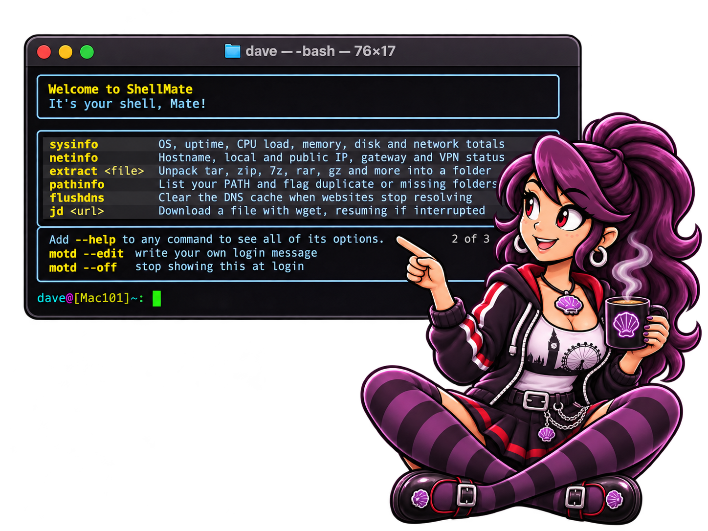

<p align="center">
  <!-- When the final ShellMate wordmark is committed, it can replace this mascot header. -->
  
</p>

<h1 align="center">ShellMate</h1>

<p align="center">
  <strong>It's your shell, mate.</strong><br>
</p>

<p align="center">
  <a href="https://github.com/macg4dave/ShellMate/releases"></a>
  
  
  <a href="https://github.com/macg4dave/ShellMate/issues"></a>
</p>

<p align="center">
  <a href="#install-in-one-command">Install</a> ·
  <a href="#meet-your-new-toolbox">Commands</a> ·
  <a href="#where-it-works">Platforms</a> ·
  <a href="#see-it-in-action">Screenshots</a> ·
  <a href="#for-the-tinkerers">Advanced</a>
</p>

---

**ShellMate makes Bash more useful without trying to replace Bash.** It adds small, memorable commands for checking your system, understanding your network, extracting archives, downloading files and keeping your environment tidy.

## Install in one command

Just open a terminal and run:

```bash
curl -fsSL https://github.com/macg4dave/ShellMate/releases/latest/download/shellmate-install.sh | bash
```

**Want to clone it?** This works too:

```bash
git clone https://github.com/macg4dave/ShellMate.git
cd ShellMate
bash scripts/install.sh --repo "$(pwd)"            # install
```

ZIP/tarball are available in [Releases](https://github.com/macg4dave/ShellMate/releases)


### A note for Mac users

Modern macOS opens **zsh** by default. ShellMate is for **Bash**, including Apple's system Bash 3.2. You can try it without changing your default shell:

```bash
bash -l
sysinfo
```

### A note for Windows users

Run ShellMate **inside your WSL Linux distribution**, not in PowerShell, Bash in the Windows Terminal is a great place to run it.

## Meet your new toolbox

No complicated subcommands to memorise. These are the helpers you'll actually reach for:

| Command | What it does | Example |
| --- | --- | --- |
| `sysinfo` | CPU, RAM, disk, uptime, load and network totals in one readable view | `sysinfo` |
| `netinfo` | Local hostname, interface, gateway, IP, VPN and optional public-IP details | `netinfo ` |
| `extract` | Unpack ZIP, TAR, 7z, RAR and other supported archives using installed tools | `extract downloads.zip` |
| `flushdns` | Clear the DNS cache with OS-aware, best-effort handling | `flushdns` |
| `jd` | Download a file using wget with resume-friendly behaviour | `jd https://example.org/file.iso` |
| `jdir` | Fetch a directory recursively with wget | `jdir https://example.org/files/` |
| `motd` | View, customise or turn off your terminal welcome | `motd --edit` |

### For Mac power users

Two extra helpers are available on macOS:

- `cdf` — switch to the folder shown in the frontmost Finder window.
- `gosu` — launch a red coloured Terminal `sudo -s'.

## See it in action

<p align="center">
  <a href="docs/images/screenshots/mac_coffee.png"></a>
  <br><sub>macOS · Bash welcome and built-in commands</sub>
</p>

<table>
  <tr>
    <td align="center" width="50%">
      <a href="docs/images/screenshots/gnome_term.png"></a>
      <br><sub>Linux · GNOME Terminal · system information</sub>
    </td>
    <td align="center" width="50%">
      <a href="docs/images/screenshots/windows_wsl.png"></a>
      <br><sub>Windows · WSL · Bash inside Windows Terminal</sub>
    </td>
  </tr>
</table>

<!-- Optional artwork slot: add the finished Ruby + ShellMate banner to docs/branding/
     and link it here after the image has been committed. -->

## Where it works

| Environment | Coverage | Notes |
| --- | --- | --- |
| **macOS** | Supported Bash target; real-Mac checks are manual | Works with system `/bin/bash` 3.2; zsh is not the target shell. |
| **Ubuntu** | Automated disposable-container test target | The Linux baseline. |
| **Debian** | Automated disposable-container test target; best-effort distro support | Tested with a slim image to expose missing optional tools. |
| **Fedora** | Automated disposable-container test target; best-effort distro support | Includes the non-login Bash setup path. |
| **Windows + WSL** | WSL-specific regression checks and a real-world screenshot | Runs inside Linux Bash, not native Windows shells. |
| **Other Linux** | Best effort; not each distro individually tested | Intended for common Bash environments, including RHEL-family, Arch, openSUSE and Alpine, subject to system tools. |

The Linux test suite runs in **Ubuntu 24.04, Debian 12, Fedora 41 and an Alpine-based Bash 3.2 image**. Bash 3.2 testing catches incompatible syntax; it is **not** a substitute for testing Apple's BSD userland on a real Mac.

Linux dependency bootstrapping recognises `apt`, `dnf`, `yum`, `pacman`, `zypper` and `apk`; macOS uses Homebrew for optional packages. That does not mean every distribution has an identical test guarantee.

See the [compatibility contract](docs/v2.0/compatibility_contract.md) for the precise supported/best-effort distinction.

### WSL: a small detail that matters

Files on Windows drives such as `/mnt/c` sometimes appear executable to Linux, making a normal coloured `ls` list look as if *everything* is a program. ShellMate detects those WSL mounts and makes regular files readable and directories easy to spot, without changing Linux-drive listings.

Prefer blue directories instead of the default yellow?

```bash
export BASH_PROFILE_WSL_DIR_COLOR="01;34"
```

It's optional, and it doesn't require changing your Windows settings.

## Your welcome message, your way

The first **three** interactive Bash sessions introduce ShellMate's commands, then the welcome stops automatically. Bring it back any time:

```bash
motd              # show the welcome
motd --edit       # write your own login message
motd --off        # disable it
motd --on         # enable it again
```

Your custom message is plain text at `~/.config/my-mac-bash-profile/motd`.

## Sensible defaults, room to tinker

ShellMate uses small Bash modules in `profile.d/` rather than a large plugin framework.

### Script-friendly output

`sysinfo` and `netinfo` offer stable `--kv` output, with one `key=value` per line instead of colours or decorative tables:

```bash
sysinfo --kv
netinfo --kv

local_ip=$(netinfo --kv | awk -F= '/^local_ip=/ {print $2}')
printf 'Local IP: %s\n' "$local_ip"
```

The field names and ordering are documented in the [helper contract](docs/v2.0/helper_contract.md).

## Updates, backups and removal

To update an installation, rerun the **same one-line release installer**. By default the installer backs up what it replaces, including the existing ShellMate installation.

To review changes before applying them:

```bash
cd ShellMate
bash scripts/install.sh --repo "$(pwd)" --dry-run
```

To remove ShellMate, first check where your login profile points:

```bash
readlink ~/.bash_profile
```

**Only if** it points to the ShellMate installation, remove that symlink. Then restore any saved `~/.bash_profile.bak.*` backup you want to keep, remove the ShellMate-managed block between the `my-mac-bash-profile` markers in `~/.bashrc` (Linux), and remove `~/.my-mac-bash-profile` if no longer needed. Avoid deleting a `~/.bash_profile` you have since customised.

## Help! My terminal isn't behaving

**Nothing is loading?** Confirm you're in Bash:

```bash
echo "$BASH_VERSION"
```

If that's empty, launch `bash -l`. On Linux, remember that login and non-login Bash read different startup files; the installer normally handles that.

**Want to skip all ShellMate modules while investigating?**

```bash
BASH_PROFILE_SAFE_MODE=1 bash -l
```

**Want to inspect exactly what loaded?**

```bash
mm_bash_profile_doctor
```

There is also the nuclear *Bash-only* fallback `bash --noprofile --norc`, which does not read your startup files. A mistaken `exit`, `logout` or `set -e` in a sourced module is guarded so it does not unexpectedly close the user's shell.

For problems, suggestions or bug reports, open a [GitHub issue](https://github.com/macg4dave/ShellMate/issues).

## For the tinkerers

Everything is ordinary Bash. No runtime package manager, no extra service and no hidden configuration database.

```text
.bash_profile            Bash entry point and module loader
profile.d/               Small cross-platform and OS-specific helpers
scripts/install.sh       Installer, dry-run and backups
scripts/bootstrap-*.sh   Optional system-tool setup
tests/                   Smoke, regression, safety and contract tests
docker/                  Throwaway distro test environments
docs/v2.0/               Compatibility, helper and configuration contracts
```

From a cloned checkout:

```bash
make lint                          # ShellCheck (install it first)
make test                          # Bash smoke, regression, safety and contract tests
make docker-test                   # Ubuntu, Debian, Fedora and Bash 3.2
make docker-test TARGETS="debian bash32"
DOCKER=podman make docker-test     # prefer Podman? No problem
make hooks                         # run lint + tests before each commit
```

The container tests run a **real install in a disposable HOME** and check that a new Bash login session can load the helpers. They do **not** run automatically as GitHub test CI on every push; the GitHub workflow currently publishes tagged releases. Check the [release process](docs/v2.0/release_process.md) and [changelog](docs/v1.0/CHANGELOG.md) for details.

**Contributions welcome:** keep changes Bash 3.2-compatible, safe to source and friendly when optional tools are missing. Read [AGENTS.md](AGENTS.md) and the [helper contract](docs/v2.0/helper_contract.md) before adding a command.

---

<p align="center">
  <strong>ShellMate</strong> — useful tools, familiar Bash, less faffing about.<br>
  <sub>With Ruby keeping an eye on the terminal.</sub>
</p>
